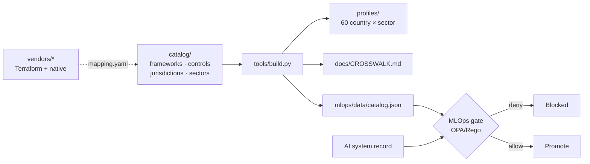

# AI Governance Compliance as Code

Vendor-native AI governance policies, an MLOps compliance gate, and country × sector compliance profiles — all as code, each fact checked against its source on **13 October 2026** and labelled primary, secondary or unverified.

**Explore the crosswalk:** https://caiotk.github.io/ai-governance-compliance-as-code/

> Not legal advice. This repository turns published obligations into reviewable, testable controls. The catalogue labels every fact `primary`, `secondary` or `unverified` ([docs/SOURCES.md](docs/SOURCES.md)); check the primary text before you rely on it.

## What is in here

| Layer | Where | What it gives you |
|---|---|---|
| **Unified control set** | [`catalog/controls.yaml`](catalog/controls.yaml) | 20 controls (AIG-01 … AIG-20) mapped clause-by-clause to ISO/IEC 27001, ISO/IEC 42001, zero trust, the EU AI Act (as amended by Reg (EU) 2026/1744), US federal and state law, GDPR, APRA CPS 230/234, RBNZ BS11, the Australian Privacy Act and the NZ Privacy Act, plus national laws for Brazil, Chile, Argentina, Japan and Singapore. [Crosswalk](docs/CROSSWALK.md). |
| **Vendor policy packs** | [`vendors/`](vendors/) | Terraform **and** native-format policies for Microsoft Foundry, Copilot Studio, Amazon Bedrock, Google Cloud Vertex AI, OpenAI, Anthropic Claude and Meta Llama, each mapped to the controls and validated in CI. |
| **MLOps governance gate** | [`mlops/`](mlops/) | OPA/Rego policies that evaluate an AI system record against every framework that applies to its countries, sector and entity types. Date-aware: obligations not yet in force are warnings with their start date. Reusable as a GitHub Actions workflow. |
| **Compliance profiles** | [`profiles/`](profiles/) | 60 generated profiles (10 countries × 6 sectors): the laws and guidance that apply, what pushes a system into higher risk, the required controls, which vendor packs cover them, and a pre-filled system record to run through the gate. |

Countries: Brazil, Chile, Argentina, Portugal, Spain, United States, Australia, New Zealand, Japan, Singapore.
Sectors: health, financial services, public sector, agriculture, mining, technology companies.

## Quick start

```bash
pip install pyyaml jsonschema cfn-lint  # plus opa, terraform, bicep on PATH
python3 tools/build.py  # validate the catalogue, regenerate profiles and crosswalk
opa test mlops/policies mlops/tests mlops/data/catalog.json
python3 tools/gate.py mlops/examples/compliant/*.yaml  # ALLOW
python3 tools/gate.py --expect-fail mlops/examples/noncompliant/*.yaml  # DENY, with every finding
tools/ci.sh  # everything CI runs
```

### Run the gate on your own system

1. Copy the pre-filled record for your country and sector, e.g. [`profiles/nz/fsi.system.yaml`](profiles/nz/fsi.system.yaml).
2. Complete every field (meanings are in [`mlops/schema/ai-system.schema.json`](mlops/schema/ai-system.schema.json)). Set `context.entity_types` to switch on gated regimes (`apra_regulated`, `nz_registered_bank`, `mas_regulated`, `critical_infrastructure`, `us_bank`, `gpai_provider`), and `context.us_states` / `us_localities` for US state and city laws.
3. `python3 tools/gate.py my-system.yaml` — exit code 1 means a blocking finding.

### Use the gate in your model pipeline

```yaml
jobs:
  governance:
    uses: caiotk/ai-governance-compliance-as-code/.github/workflows/ai-governance-gate.yml@main
    with:
      systems: "ai-systems/*.yaml"
```

The job fails on any `deny` finding, so a model cannot be promoted until its record is compliant.

## Vendor packs

| Pack | Native governance tooling used | Formats |
|---|---|---|
| [`azure-foundry`](vendors/azure-foundry/) | Azure Policy built-ins (approved models, key access, network, CMK, diagnostics; EU AI Act initiative), content filters (`raiPolicies`), Defender for AI services, Purview DSPM for AI | Terraform `azurerm`, Bicep, Azure Policy JSON |
| [`copilot-studio`](vendors/copilot-studio/) | Power Platform data policies (DLP), Managed Environments, tenant isolation, Purview audit, agent inventory | Terraform `microsoft/power-platform`, DLP JSON, PowerShell, pac CLI |
| [`aws-bedrock`](vendors/aws-bedrock/) | Bedrock Guardrails, organization-level guardrail enforcement (`BEDROCK_POLICY`), SCPs with `bedrock:GuardrailIdentifier`, model invocation logging, VPC endpoints, KMS | Terraform `aws`, CloudFormation, SCP JSON |
| [`gcp-vertex`](vendors/gcp-vertex/) | Organization Policy (`vertexai.allowedModels`, resource locations, CMEK), Model Armor floor settings, Data Access audit logs, VPC Service Controls | Terraform `google`, gcloud org-policy YAML, REST |
| [`openai`](vendors/openai/) | Administration API: project model allow-lists, hosted-tool permissions, data retention, spend limits, service accounts, audit logs; Moderation API | Terraform `openai/openai`, Admin API scripts |
| [`anthropic-claude`](vendors/anthropic-claude/) | Admin API workspaces, keys, usage/cost reports; Compliance API activity feed; `inference_geo` data residency | Terraform posture checks (no official provider), Admin API scripts |
| [`meta-llama`](vendors/meta-llama/) | Llama Guard 4 (S1–S14), Prompt Guard 2, LlamaFirewall, Llama 4 Community License obligations; approved-model policy on Vertex, Foundry and Bedrock | Terraform (per host), policy YAML, Python |

Every pack's `mapping.yaml` lists the controls it **implements** and the **gaps** it cannot close on the platform, and its README has an "Unverified / known gaps" section.

## How the pieces fit



## Automation

| Workflow | Purpose |
|---|---|
| [`validate.yml`](.github/workflows/validate.yml) | Catalogue validation, generated files up to date, Rego tests, gate examples, Terraform fmt/validate, Bicep build, cfn-lint, JSON/YAML/shell/Python syntax |
| [`ai-governance-gate.yml`](.github/workflows/ai-governance-gate.yml) | The MLOps gate as a reusable workflow; comments findings on pull requests |
| [`regulatory-watch.yml`](.github/workflows/regulatory-watch.yml) | Weekly: opens an issue listing obligations commencing in the next 120 days, and warns when the catalogue needs re-verification |
| [`deploy-site.yml`](.github/workflows/deploy-site.yml) | Publishes the crosswalk explorer to GitHub Pages after validation passes |

## Status highlights the catalogue encodes (Oct 2026)

- EU AI Act high-risk obligations were postponed by Regulation (EU) 2026/1744: Annex III from **2 Dec 2027**, Annex I from **2 Aug 2028**. Art 50 transparency applies from 2 Aug 2026.
- The GDPR part of the Digital Omnibus is **not** law; the current GDPR is the baseline.
- Colorado's AI Act was replaced by SB 26-189 (notice, explanation and human review), effective **1 Jan 2027**. SR 11-7 was superseded by SR 26-2, which excludes generative AI.
- APRA's letter to industry on AI (30 Apr 2026) sets expectations under CPS 230/234. RBNZ BS11 stays in force until the Deposit Takers Act standards commence (due 1 Dec 2028; revocation date not confirmed).
- Australian APP 1.7–1.9 automated-decision transparency starts **10 Dec 2026**; NZ IPP 3A has applied since 1 May 2026.
- MAS finalised its AI Risk Management Guidelines in Oct 2026 (phased from Oct 2027). Brazil's PL 2338, Chile's AI bill and Spain's national AI law are still bills.

## Contributing

Facts go in `catalog/`, never in generated files. Run `python3 tools/build.py` and `tools/ci.sh` before opening a pull request. Vendor packs follow [docs/VENDOR_PACK_SPEC.md](docs/VENDOR_PACK_SPEC.md).

## Licence

MIT. Built by [Caio Augusto Tkalec](https://www.linkedin.com/in/caiotk).
