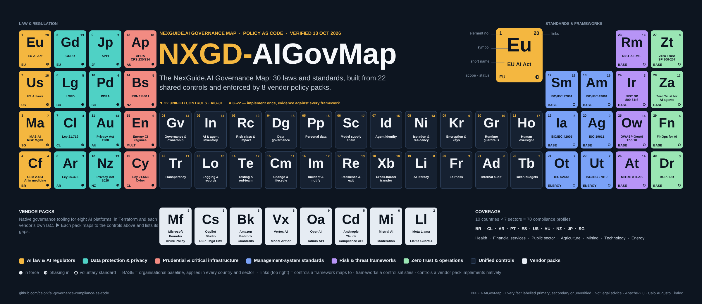
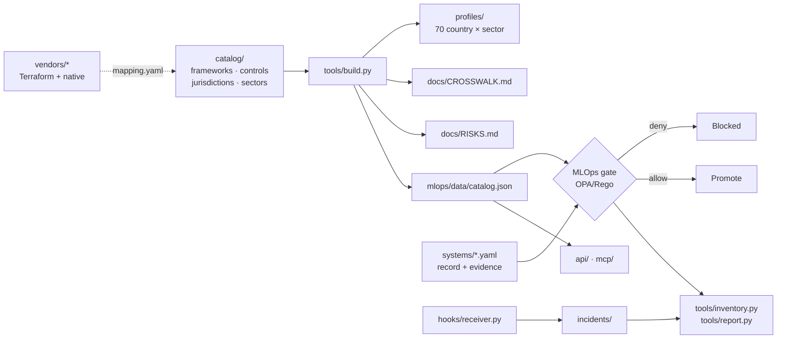

# AI Governance Compliance as Code

[](https://github.com/caiotk/ai-governance-compliance-as-code/actions/workflows/validate.yml)
[](LICENSE)
[](docs/SOURCES.md)

Vendor-native AI governance policies, an MLOps compliance gate, a risk catalogue, an inventory and country × sector compliance profiles — all as code, each fact checked against its source on **13 October 2026** and labelled primary, secondary or unverified.

**Free and open source** (Apache-2.0). The commercial edition, **NexGuide.AI GovMap**, adds an evidence database, approval workflows, PDF audit packs and a hosted API on the same catalogue — see [Editions](#editions).

**Explore the crosswalk:** https://caiotk.github.io/ai-governance-compliance-as-code/



<sub>**NXGD-AIGovMap** — the NexGuide.AI Governance Map. Reproduce it unmodified with its footer; see [TRADEMARKS.md](TRADEMARKS.md).</sub>

> Not legal advice. This repository turns published obligations into reviewable, testable controls. The catalogue labels every fact `primary`, `secondary` or `unverified` ([docs/SOURCES.md](docs/SOURCES.md)); check the primary text before you rely on it.

## What is in here

| Layer | Where | What it gives you |
|---|---|---|
| **Unified control set** | [`catalog/controls.yaml`](catalog/controls.yaml) | 22 controls (AIG-01 … AIG-22) mapped clause-by-clause to ISO/IEC 27001, ISO/IEC 42001, ISO/IEC 42005 (impact assessment), ISO 19011:2026 (auditing), NIST AI RMF 1.0 and AI 600-1, NIST SP 800-61r3 (incident response), OWASP LLM Top 10 2026 and Agentic Top 10, MITRE ATLAS, zero trust (SP 800-207 and Anthropic's zero-trust-for-agents guidance), the EU AI Act (as amended by Reg (EU) 2026/1744), US federal and state law, GDPR, APRA CPS 230/234, RBNZ BS11, the Australian Privacy Act and the NZ Privacy Act, plus national laws for Brazil, Chile, Argentina, Japan and Singapore, and the energy-sector regimes (NERC CIP, SOCI/CIRMP, Ley 21.663, NIS2/NCCS/CER, ESP Act, Cybersecurity Act/CCoP 2026, IEC 62443, ISO/IEC 27019). [Crosswalk](docs/CROSSWALK.md). |
| **AI FinOps and model selection** | [`finops/`](finops/) | A verified model catalogue with functional tiers (daily driver → workhorse → specialist), a selector that prices every workload and decides single- vs multi-model routing under RAI, residency, cost, quality and continuity constraints, token-cost brokerage (LiteLLM budgets, APIM token limits), cloud budgets and token alarms, OTel/Prometheus metrics. [README](finops/README.md). |
| **Push-button BCP/DR** | [`bcp/`](bcp/) | Failover, failback and timed drills on the routing state from one workflow button, multi-region Terraform/Bicep, a runbook mapped to SP 800-34, CSF 2.0, CPS 230, DORA and the AI Act. [README](bcp/README.md). |
| **Vendor policy packs** | [`vendors/`](vendors/) | Terraform **and** native-format policies for Microsoft Foundry, Copilot Studio, Amazon Bedrock, Google Cloud Vertex AI, OpenAI, Anthropic Claude, Mistral AI and Meta Llama, each mapped to the controls and validated in CI. |
| **MLOps governance gate** | [`mlops/`](mlops/) | OPA/Rego policies that evaluate an AI system record against every framework that applies to its countries, sector and entity types. Date-aware: obligations not yet in force are warnings with their start date. Reusable as a GitHub Actions workflow. |
| **Compliance profiles** | [`profiles/`](profiles/) | 70 generated profiles (10 countries × 7 sectors): the laws and guidance that apply, what pushes a system into higher risk, the required controls, which vendor packs cover them, and a pre-filled system record to run through the gate. |
| **Risk catalogue** | [`catalog/risks.yaml`](catalog/risks.yaml) | 36 AI risks in 9 categories (security, privacy, safety, fairness, transparency, agentic, operational, supply chain, compliance), each mapped to the controls that treat it and to OWASP LLM/Agentic Top 10, MITRE ATLAS and NIST AI 600-1. The gate names the risks that apply to each system. [RISKS.md](docs/RISKS.md). |
| **Inventory and evidence** | [`systems/`](systems/) | Your AI register in git: one record per system, an `evidence` block with freshness checks, `tools/inventory.py` for the Markdown/CSV/JSON register, weekly review reminders as issues. [INVENTORY.md](docs/INVENTORY.md). |
| **Runtime hooks and incidents** | [`hooks/`](hooks/), [`incidents/`](incidents/) | A webhook receiver that turns Bedrock, Defender for AI, Model Armor and moderation-gate events into incident records linked to the system, surfaced in the inventory, reports and reminders. |
| **Audit reports** | [`tools/report.py`](tools/report.py) | A Markdown audit pack per system: decision, frameworks, every required control with clause references, evidence on file, vendor coverage, applicable risks, incidents and the review calendar. |
| **API and MCP server** | [`api/`](api/), [`mcp/`](mcp/) | Read-only HTTP/JSON API and a Model Context Protocol server over the catalogue, profiles, inventory and gate, so assistants and pipelines query verified facts instead of guessing. |

Countries: Brazil, Chile, Argentina, Portugal, Spain, United States, Australia, New Zealand, Japan, Singapore.
Sectors: health, financial services, public sector, agriculture, mining, technology companies, energy (oil, gas and electricity).

### Organisational baseline standards

Standards marked `baseline: true` in [`catalog/frameworks.yaml`](catalog/frameworks.yaml) apply to every system in every country and sector, on top of the law that binds it:

| Standard | What the gate checks |
|---|---|
| ISO/IEC 27001:2022, ISO/IEC 42001:2023 | Management-system controls behind AIG-01 … AIG-21; AIG-21 requires the system to sit in a planned internal audit programme (cl. 9.2). |
| ISO 19011:2026 | Audit programme, last audit within the programme cycle (12 months here; ISO 19011 sets no cadence), findings tracked to closure (warnings). |
| ISO/IEC 42005:2025 | Impact-assessment method recorded, scheduled review for high-risk/consequential systems, interested parties identified (warnings). |
| NIST AI RMF 1.0 + AI 600-1 | Risk tolerance documented (MAP 1.5 / GOVERN 1.3), post-deployment monitoring (MEASURE 2.4 / MANAGE 4.1). |
| NIST SP 800-61r3 (CSF 2.0 profile; r2 withdrawn 3 Apr 2025) | Lessons-learned loop (ID.IM), AI telemetry into the SOC (DE.CM). |
| OWASP GenAI — LLM Top 10 2026, Agentic Top 10 | Threat model: required for agentic systems (deny), recommended for user-facing ones (warn); output validation for agents (deny). |
| MITRE ATLAS 2026.09 | Per-action agent telemetry for scope-drift detection (deny); AI bill of materials (warn). |
| FinOps Framework — FinOps for AI | Budget defined (deny, AIG-22); token limits enforced, model-selection record, cost-allocation tags (warn). |
| BCP/DR — NIST SP 800-34, CSF 2.0 RC/PR.IR, ISO 22301 | Critical operations: secondary route, RTO/RPO, drill within 12 months (warn); a missing or stale annual exercise is a **deny** for APRA-regulated entities (CPS 230 para 43). |
| Zero trust — NIST SP 800-207 + Anthropic *Zero trust for AI agents* (2026) | Short-lived credentials, tool allow-list, egress allow-listing (deny), sandboxed execution and IdP-federated identity (warn), per-action approval for irreversible agent actions (deny). |

OWASP, MITRE ATLAS and the Anthropic guidance are not law; where the gate says **deny** for them it is this repository's organisational baseline for agents, stated as such in `mlops/policies/frameworks.rego`. Change the severity there if your baseline differs.

## Quick start

Use this repository as a **template** ("Use this template" on GitHub) or fork it, then:

```bash
make setup      # pip deps; reports missing opa / terraform / bicep / cfn-lint (or open the dev container)
make build      # validate the catalogue, regenerate profiles, crosswalk, risks, catalog.json
make test       # everything CI runs (TF=0 to skip Terraform)
make gate       # evaluate systems/*.yaml → build/gate.md + gate.sarif
make inventory  # docs/INVENTORY.md, inventory.csv, inventory.json
make report     # Markdown audit pack per system → build/reports/
make reviews    # what falls due in 30 days (evidence, assessments, audits, drills)
make api        # read-only API on :8080   ·   make mcp → MCP server on stdio
```

Without make:

```bash
pip install -r requirements.txt  # plus opa, terraform, bicep on PATH
python3 tools/build.py
opa test mlops/policies mlops/tests mlops/data/catalog.json
python3 tools/gate.py mlops/examples/compliant/*.yaml  # ALLOW
python3 tools/gate.py --expect-fail mlops/examples/noncompliant/*.yaml  # DENY, with every finding
python3 tools/select_model.py finops/examples/eu-support-chatbot.yaml  # price a workload, decide routing, emit broker config
python3 tools/dr.py drill --workload eu-support-chatbot --rto-minutes 30  # timed failover drill
```

### Run the gate on your own system

1. Copy the pre-filled record for your country and sector, e.g. [`profiles/nz/fsi.system.yaml`](profiles/nz/fsi.system.yaml).
2. Complete every field (meanings are in [`mlops/schema/ai-system.schema.json`](mlops/schema/ai-system.schema.json)). Set `context.entity_types` to switch on gated regimes (`apra_regulated`, `nz_registered_bank`, `mas_regulated`, `critical_infrastructure`, `us_bank`, `gpai_provider`); the baseline standards above apply automatically, and `context.us_states` / `us_localities` for US state and city laws.
3. Add an `evidence` block (see [`systems/customer-support-assistant.yaml`](systems/customer-support-assistant.yaml)) listing where the proof for each control lives and when it was last reviewed; the gate warns on missing and expired evidence and, with `enforce: true`, blocks on expired evidence.
4. `python3 tools/gate.py my-system.yaml` — exit code 1 means a blocking finding. The decision also lists the risks that apply (`docs/RISKS.md`) and the evidence status per control.

### Use the gate in your model pipeline

```yaml
jobs:
  governance:
    uses: caiotk/ai-governance-compliance-as-code/.github/workflows/ai-governance-gate.yml@v1
    with:
      systems: "ai-systems/*.yaml"
      # policy_repo: my-org/my-fork   # forks evaluate against their own copy
      # policy_ref: v1.0.0            # pin the catalogue version
```

The job fails on any `deny` finding, so a model cannot be promoted until its record is compliant. Findings are posted as a pull-request comment, a job summary and SARIF (Security → Code scanning). Other CI systems: run `python3 tools/gate.py --sarif gate.sarif systems/*.yaml` in any job with Python 3.12 and `opa`.

### Ask the catalogue (API and MCP)

```bash
python3 api/server.py --port 8080      # GET /v1/jurisdictions/AU?sector=fsi · /v1/controls/AIG-11 · /v1/risks?category=agentic · POST /v1/evaluate
python3 mcp/server.py                  # MCP over stdio: frameworks_for, get_control, crosswalk, list_risks, get_profile, evaluate_system, list_systems …
```

Claude Desktop / Claude Code / Cursor: `{"mcpServers": {"ai-governance": {"command": "python3", "args": ["/path/to/repo/mcp/server.py"]}}}`.

## Vendor packs

| Pack | Native governance tooling used | Formats |
|---|---|---|
| [`azure-foundry`](vendors/azure-foundry/) | Azure Policy built-ins (approved models, key access, network, CMK, diagnostics; EU AI Act initiative), content filters (`raiPolicies`), Defender for AI services, Purview DSPM for AI | Terraform `azurerm`, Bicep, Azure Policy JSON |
| [`copilot-studio`](vendors/copilot-studio/) | Power Platform data policies (DLP), Managed Environments, tenant isolation, Purview audit, agent inventory | Terraform `microsoft/power-platform`, DLP JSON, PowerShell, pac CLI |
| [`aws-bedrock`](vendors/aws-bedrock/) | Bedrock Guardrails, organization-level guardrail enforcement (`BEDROCK_POLICY`), SCPs with `bedrock:GuardrailIdentifier`, model invocation logging, VPC endpoints, KMS | Terraform `aws`, CloudFormation, SCP JSON |
| [`gcp-vertex`](vendors/gcp-vertex/) | Organization Policy (`vertexai.allowedModels`, resource locations, CMEK), Model Armor floor settings, Data Access audit logs, VPC Service Controls | Terraform `google`, gcloud org-policy YAML, REST |
| [`openai`](vendors/openai/) | Administration API: project model allow-lists, hosted-tool permissions, data retention, spend limits, service accounts, audit logs; Moderation API | Terraform `openai/openai`, Admin API scripts |
| [`anthropic-claude`](vendors/anthropic-claude/) | Admin API workspaces, keys, usage/cost reports; Compliance API activity feed; `inference_geo` data residency | Terraform posture checks (no official provider), Admin API scripts |
| [`mistral`](vendors/mistral/) | Admin API member/role inventory and audit-log export (Enterprise), Moderation API as a CI gate, server-side `guardrails` (moderation_llm_v2), ZDR and Sweden-hosted processing evidence | Terraform posture checks (no official provider), Admin API and moderation scripts |
| [`meta-llama`](vendors/meta-llama/) | Llama Guard 4 (S1–S14), Prompt Guard 2, LlamaFirewall, Llama 4 Community License obligations; approved-model policy on Vertex, Foundry and Bedrock | Terraform (per host), policy YAML, Python |

Every pack's `mapping.yaml` lists the controls it **implements** and the **gaps** it cannot close on the platform, and its README has an "Unverified / known gaps" section.

## How the pieces fit



## Automation

| Workflow | Purpose |
|---|---|
| [`validate.yml`](.github/workflows/validate.yml) | Catalogue validation, generated files up to date, Rego tests, gate examples, Terraform fmt/validate, Bicep build, cfn-lint, JSON/YAML/shell/Python syntax |
| [`ai-governance-gate.yml`](.github/workflows/ai-governance-gate.yml) | The MLOps gate as a reusable workflow (`policy_repo` / `policy_ref` inputs); comments findings on pull requests and uploads SARIF |
| [`inventory.yml`](.github/workflows/inventory.yml) | Builds the AI inventory from `systems/` on every change and weekly; keeps `docs/INVENTORY.md` current |
| [`review-reminders.yml`](.github/workflows/review-reminders.yml) | Weekly: one issue per system for evidence, impact-assessment reviews, audits, DR drills and model-selection refreshes falling due in 30 days, plus open high incidents |
| [`release.yml`](.github/workflows/release.yml) | Tags `vX.Y.Z` → validated release with the catalogue bundle, `catalog.json`, the NXGD-AIGovMap visual and checksums; moves the `v1` tag |
| [`cla.yml`](.github/workflows/cla.yml) | Asks first-time contributors to sign the [CLA](CLA.md) |
| [`regulatory-watch.yml`](.github/workflows/regulatory-watch.yml) | Weekly: opens an issue listing obligations commencing in the next 120 days, and warns when the catalogue needs re-verification |
| [`deploy-site.yml`](.github/workflows/deploy-site.yml) | Publishes the crosswalk explorer to GitHub Pages after validation passes |
| [`model-selection.yml`](.github/workflows/model-selection.yml) | Prices every workload profile, decides routing, posts the decision on pull requests; weekly catalogue-freshness check opens a refresh issue |
| [`bcp-dr.yml`](.github/workflows/bcp-dr.yml) | **Push-button BCP/DR**: status, failover, failback (in the `production` environment, so required reviewers make it a two-person control) and quarterly timed drills with records in `bcp/drills/` |

## Status highlights the catalogue encodes (Oct 2026)

- EU AI Act high-risk obligations were postponed by Regulation (EU) 2026/1744: Annex III from **2 Dec 2027**, Annex I from **2 Aug 2028**. Art 50 transparency applies from 2 Aug 2026.
- The GDPR part of the Digital Omnibus is **not** law; the current GDPR is the baseline.
- Colorado's AI Act was replaced by SB 26-189 (notice, explanation and human review), effective **1 Jan 2027**. SR 11-7 was superseded by SR 26-2, which excludes generative AI.
- APRA's letter to industry on AI (30 Apr 2026) sets expectations under CPS 230/234. RBNZ BS11 stays in force until the Deposit Takers Act standards commence (due 1 Dec 2028; revocation date not confirmed).
- Australian APP 1.7–1.9 automated-decision transparency starts **10 Dec 2026**; NZ IPP 3A has applied since 1 May 2026.
- MAS finalised its AI Risk Management Guidelines in Oct 2026 (phased from Oct 2027). Brazil's PL 2338, Chile's AI bill and Spain's national AI law are still bills.

## Editions

This repository is the **free, open-source edition** and is complete for teams that run AI governance from git. Where a capability needs a server, a database or a team behind it, the tools say so with a short note — "available in NexGuide.AI GovMap" — and keep working.

| | Open source (here) | NexGuide.AI GovMap |
|---|---|---|
| Catalogue, controls, risks, profiles, vendor packs, gate, CI workflow | ✅ | ✅ same catalogue |
| Inventory | YAML in `systems/` + generated register | Database register with search, ownership views, history; imports from Foundry, Bedrock and Copilot Studio exports |
| Evidence | Evidence-as-code block, freshness checks | Evidence vault: upload, hash, versioning, reuse, reviewer sign-off |
| Workflow | CODEOWNERS, required reviews, reminder issues | Approval workflows with roles and an audit trail |
| Runtime | Webhook receiver → incident records | Hosted receivers, triage, automatic re-evaluation, promotion block on critical incidents, Slack/Teams |
| Reports | Markdown audit pack | PDF audit packs with the evidence register, portfolio dashboard |
| API / MCP | Read-only, self-hosted | Write API with API keys and roles |
| Support | Community | Commercial |

Details and roadmap: [docs/EDITIONS.md](docs/EDITIONS.md).

## Contributing

Facts go in `catalog/`, never in generated files. Run `make build` and `make test` before opening a pull request; first-time contributors sign the [CLA](CLA.md). See [CONTRIBUTING.md](CONTRIBUTING.md), [SECURITY.md](SECURITY.md) and [docs/VENDOR_PACK_SPEC.md](docs/VENDOR_PACK_SPEC.md).

## Licence and trademarks

[Apache License 2.0](LICENSE) with the attribution in [NOTICE](NOTICE). **NexGuide.AI**, **NexGuide.AI GovMap** and **NXGD-AIGovMap** are trademarks of Caio Augusto Tkalec; the code is free to use, the names are not — [TRADEMARKS.md](TRADEMARKS.md). Built by [Caio TK](https://www.linkedin.com/in/caiotk).
